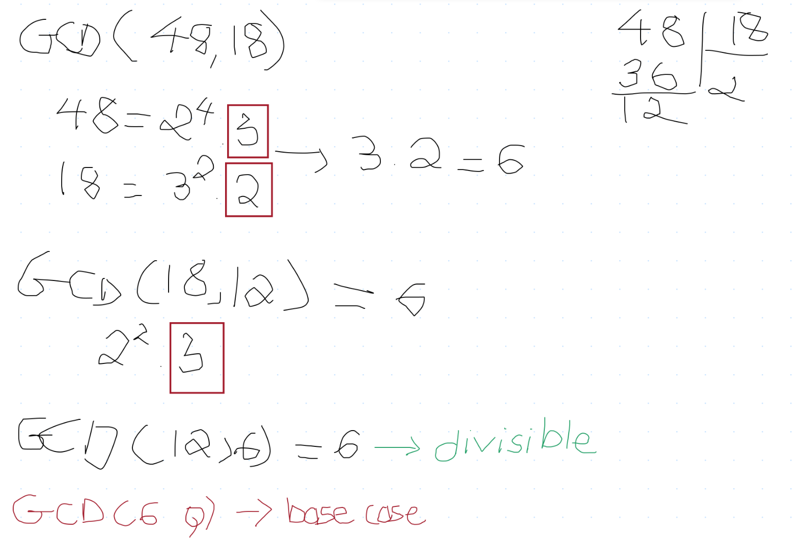

# THIS REPO IS WHERE I REVISE MY KNOWLEDGE FROM ZERO

I hope that may be helpful for you, just enjoying the process with some CP solutions, btw!!!

## MarisaOJ's solution

- [449 - Loop](loop.cpp)
- [314 - Even numbers](even-numbers.cpp)
- [542 - Factorial](factorial.cpp)
- [16 - Star Triangle](star-triangle.cpp)
- [402 - Folding paper](folding-paper.cpp)
- [315 - Fraction](fraction.cpp)

    

        
👉 Visual example for 315

         
        
    

- [316 - Divisors](divisors.cpp)
- [24 - Complex Exponentiation](complex-expo.cpp)